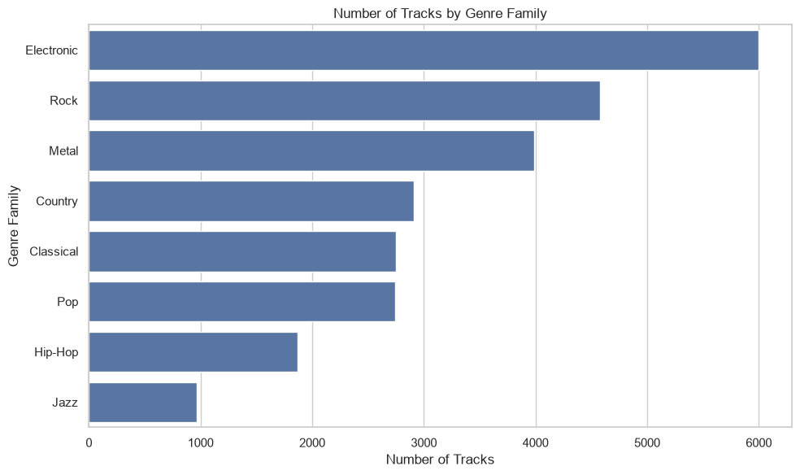
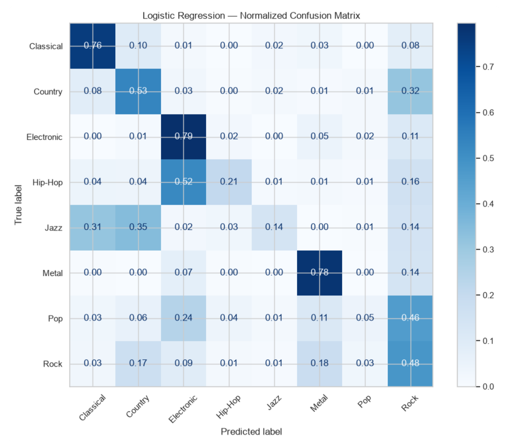
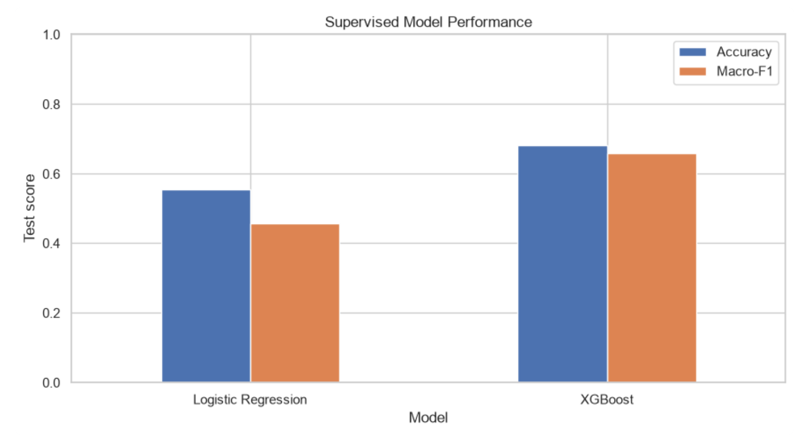

# CS4641 Midterm Checkpoint

## 1. Introduction and Background

**The main goal of this project is to predict a song’s genre from features like loudness, tempo, danceability and energy, using both supervised and unsupervised learning.**

### Literature Review

- The first article looks through which supervised learning model classifies a songs genre the most accurately. From the article, Random forest wins at 79.40% accuracy, with decision tree almost tied at 79.30%, Bayes was 77.28%, and k-nearest neighbors was 60.74%. They conclude random forest is the best choice for genre classification on Spotify.

- The second article “presented a paper on how researchers could automatically classify musical genres from audio signals. Claiming that his model worked as well as human classifiers” [2] This article shows how the GTZAN genre dataset became a benchmark for genre data, and argues that its feature-based view of music and genre shaped today’s music technology.

- Another study compared deep learning CNN approach, trained end-to-end, with traditional ML methods that relied on ‘hand-crafted’ time and frequency domain audio features [3].

### Dataset Description

The dataset we will be using is the Spotify track dataset from Kaggle. It contains data from Spotify’s API and includes information for ~114,000 songs. For each song, there is qualitative information such as artist, album, song name, genre, and some quantitative characteristics describing the songs audio features. These characteristics include energy, loudness, speechiness, acousticness, instrumentalness, liveness, valence, tempo, duration, musical key, danceability, mode, and a popularity score. For this project we will be focusing on predicting the genre variable.

Dataset Link: [Link](https://www.kaggle.com/datasets/maharshipandya/-spotify-tracks-dataset)

---

## 2. Problem Definition

### Problem

The genre of a song can be hard to classify and is an important part of song recommendations on streaming services. Being able to automate genre classification can help organize large libraries and improve insights. Machine learning provides a way to identify patterns from the audio features, and how that impacts the genre a song will fall into. This can also give insight into how genres differ musically.

---

## 3. Methods

### Data Preprocessing

We started with the Spotify Tracks dataset: 114,000 rows that cover 114 genre tags. Exploring it showed that the same song appears once for every genre tag it carries. Only 89,741 track_ids are unique, and 16,299 tracks have multiple labels. 

To get a cleaner prediction target, we grouped 30 related genre tags into 8 broader families: Rock, Metal, Electronic, Hip-Hop, Pop, Classical, Jazz, and Country. We excluded all other tags, which left 30,000 rows. We then removed tracks that fell into more than one family and kept one row per track. That gave a final dataset of 25,791 tracks.

We selected 12 numerical audio features, such as danceability, energy, loudness, and tempo. We split the data 80/20 with stratification, giving 20,632 training tracks and 5,159 test tracks, and reused that split for every model. We standardized features with StandardScaler, fit on the training data only so the test set stays unseen, and encoded the genre labels for XGBoost.

### Implemented solution: supervised genre-family classification

Our solution predicts a song’s genre family from 12 Spotify audio features, using the preprocessed data described above (25,791 tracks, 8 families, an 80/20 stratified split). We implemented two supervised models on the same split and features, so they can be compared directly.

### Logistic Regression and XGBoost
We used scikit-learn’s LogisticRegression in a pipeline with StandardScaler, so features on different scales don’t dominate training. We chose it because it is fast and simple, and it gives a baseline that other models must beat. We used XGBClassifier with 200 trees and max depth 5 on the unscaled features. We chose it because genre likely depends on non-linear combinations of features, which boosted trees capture well. Prior work also found tree-based models strongest [1].

## 4. Results 

## Images

*Figure 1: Number of tracks in each genre family after cleaning (25,791 total). The classes are imbalanced: Electronic has 5,996 tracks while Jazz has only 969. This is why we report macro-F1 alongside accuracy.*

*Figure 2: Logistic Regression confusion matrix, normalized by true genre (each row sums to 1). The diagonal is strong for Classical, Electronic, and Metal, but Pop is almost never predicted correctly (5% recall), and 52% of Hip-Hop tracks are misclassified as Electronic.*

*Figure 3: Test-set accuracy and macro-F1 for both models on the same 5,159 tracks. XGBoost beats Logistic Regression by 12.6 points of accuracy (0.682 vs. 0.556) and 20 points of macro-F1 (0.660 vs. 0.458), showing that non-linear feature interactions matter for predicting genre.*

## Quantitiative Metrics: 

All scores are on the held-out test set of 5,159 tracks across 8 genre families.

| Model | Accuracy | Macro-F1 | Training Time |
|---|---|---|---|
| Logistic Regression | 0.556 | 0.458 | n/a |
| **XGBoost** | **0.682** | **0.660** | 2.94 s |

## Analysis of Models:

Logistic Regression

Logistic regression reached 55.6% accuracy and 0.458 macro-F1. It does well on Classical, Electronic, and Metal (F1 about 0.72) but poorly on Pop (F1 0.08) and Jazz (F1 0.21). It draws straight-line boundaries, so it cannot capture the feature combinations that define genre, and it favors the large families. For example, 52% of Hip-Hop tracks are labeled Electronic. It works as a baseline, but a linear model is not enough.

XGBoost

XGBoost reached 68.2% accuracy and 0.660 macro-F1, which is 12.6 points of accuracy better than the baseline. It helps most on Jazz (F1 0.21 to 0.72) and Hip-Hop (0.30 to 0.57), because trees capture non-linear feature interactions. Pop (F1 0.38) and Rock (0.53) remain hardest, since they share sounds with other families. acousticness is the most important feature (about 22%). We have not tuned it yet, and our split is not grouped by artist, so scores may be slightly optimistic.

## Next Steps:

Add K-Means clustering to see if songs naturally group into genre-like clusters.
Tune XGBoost and compare it with a random forest.
Improve Pop, Jazz, and Hip-Hop, the families the models get wrong most often.
Split by artist to check that our scores aren’t inflated.
Add more genres beyond our current 8 families.

## 5. Gantt Chart

[Download the Gantt Chart](GanttChart-1.xlsx)
---

## 6. Contribution Table

| Name | Project Contributions |
|---|---|
| Tucker Albaugh | Report + Code Implementation |
| Andrew Wu | Report and Code implementation |
| Benjamin Carder | Data Cleaning + Modeling |
| Meeton Kirkuki | Report and Data Cleaning |

## 7. References

[1] M. Fiqri, F. B. S. Lizen, and M. Ikrom, “Implementation of supervised learning algorithm on Spotify music genre classification,” *Indones. J. Appl. Technol. Innov. Sci.*, vol. 2, no. 1, pp. 7–12, Feb. 2025, doi: 10.57152/ijatis.v2i1.1102.

[2] A. Jerzak, “An accidental benchmark: The history, contingent power, and lasting traces of the GTZAN dataset,” *Digit. Soc.*, vol. 4, no. 2, Art. no. 34, May 2025, doi: 10.1007/s44206-025-00191-w.

[3] H. Bahuleyan, “Music genre classification using machine learning techniques,” Apr. 2018, *arXiv:1804.01149*.

[4] B. L. Sturm, “The GTZAN dataset: Its contents, its faults, their effects on evaluation, and the future use,” *J. New Music Res.*, vol. 43, no. 2, pp. 147–172, 2014.

[5] L. Hubert and P. Arabie, “Comparing partitions,” *J. Classification*, vol. 2, no. 1, pp. 193–218, 1985.

